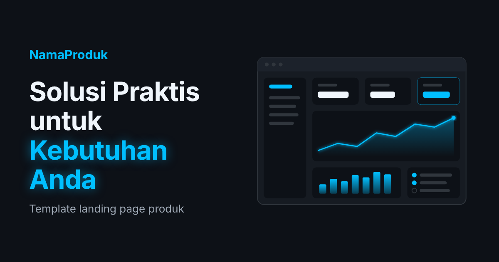

# Landing Page Produk — Template Tema Gelap Neon

Template landing page satu halaman yang responsif, ringan, dan aman. Dibangun hanya dengan **HTML, CSS, dan sedikit JavaScript murni**, tanpa framework, build tool, atau skrip pihak ketiga. Siap diubah untuk produk apa pun.



## Fitur

- **Responsif** — tampilan menyesuaikan desktop, tablet, dan ponsel, dengan menu lipat di layar kecil.
- **Bagian lengkap** — hero, fitur, testimoni, 3 paket harga (paket tengah disorot), ajakan kontak, dan footer.
- **Aman secara default** — Content-Security-Policy ketat, tanpa skrip/CDN pihak ketiga, tanpa `innerHTML`/`eval`, serta contoh header keamanan untuk server.
- **Menjaga privasi** — font Inter disimpan lokal, sehingga IP pengunjung tidak dikirim ke Google Fonts.
- **Aksesibel** — tautan "lewati ke konten", gaya fokus keyboard, label untuk pembaca layar, dan dukungan `prefers-reduced-motion`.
- **Ringan** — total aset sekitar 150 KB; ilustrasi berformat SVG.
- **Tetap berjalan tanpa JavaScript** — menu otomatis tampil sebagai baris tautan biasa.

## Struktur Folder

```
landingpage_produk/
├── index.html              # Halaman utama
├── assets/
│   ├── css/style.css       # Semua gaya & variabel warna tema
│   ├── js/main.js          # Menu mobile & tahun otomatis
│   ├── fonts/              # Font Inter (lisensi OFL)
│   └── images/             # hero.svg, favicon.svg, og-image.png
├── _headers                # Header keamanan (Netlify / Cloudflare Pages)
├── .htaccess               # Header keamanan (Apache / cPanel)
├── LICENSE
└── README.md
```

## Cara Menggunakan

1. **Unduh / clone** repositori ini:
   ```bash
   git clone https://github.com/<username>/<nama-repo>.git
   cd <nama-repo>
   ```
2. **Buka** `index.html` langsung di browser, atau jalankan server lokal (disarankan):
   ```bash
   python -m http.server 8000
   ```
   lalu buka `http://localhost:8000`.
3. **Ubah konten.** Cari komentar `UBAH:` di `index.html`. Semua bagian yang perlu diganti sudah ditandai:
   | Yang diubah | Lokasi |
   |---|---|
   | Nama produk | logo di navbar, `<title>`, meta, dan footer |
   | Judul & deskripsi | bagian hero dan `<meta name="description">` |
   | Fitur, testimoni, paket harga | bagian `#fitur`, `#testimoni`, `#harga` |
   | Email / WhatsApp | tombol di bagian `#kontak` |
   | Gambar pratinjau share | `og:url` & `og:image` (isi dengan URL lengkap situs Anda) |
4. **Ubah warna** cukup di blok `:root` paling atas `assets/css/style.css` (misalnya `--neon-blue`).
5. **Ganti gambar** `assets/images/hero.svg` dengan gambar produk Anda. Pastikan Anda memiliki hak pakainya, lalu sesuaikan atribut `alt`, `width`, dan `height`.

> **Testimoni:** gunakan hanya testimoni asli dari pelanggan yang sudah memberi izin. Hapus bagiannya jika belum ada.

## Keamanan

Halaman ini sudah memuat Content-Security-Policy lewat tag `<meta>`. Beberapa perlindungan (anti-clickjacking, HSTS, `nosniff`) **hanya bisa dipasang dari server**, jadi file konfigurasinya sudah disediakan:

| Hosting | Cara |
|---|---|
| **Netlify / Cloudflare Pages** | `_headers` otomatis terbaca saat deploy. |
| **Apache / cPanel** | `.htaccess` otomatis terbaca. Aktifkan baris HSTS setelah HTTPS berjalan. |
| **Nginx** | Salin contoh di bawah ke blok `server { }`. |
| **GitHub Pages** | Tidak mendukung header kustom; CSP dari tag `<meta>` tetap berlaku. Aktifkan **Enforce HTTPS** di pengaturan repo. |

<details>
<summary>Contoh konfigurasi Nginx</summary>

```nginx
add_header Content-Security-Policy "default-src 'none'; script-src 'self'; style-src 'self'; img-src 'self' data:; font-src 'self'; manifest-src 'self'; base-uri 'none'; form-action 'none'; frame-ancestors 'none'; upgrade-insecure-requests" always;
add_header X-Content-Type-Options "nosniff" always;
add_header X-Frame-Options "DENY" always;
add_header Referrer-Policy "strict-origin-when-cross-origin" always;
add_header Permissions-Policy "camera=(), microphone=(), geolocation=(), payment=(), usb=()" always;
add_header Strict-Transport-Security "max-age=31536000; includeSubDomains" always;
location ~ /\. { deny all; }
```
</details>

**Jika Anda menambahkan layanan pihak ketiga** (Google Analytics, embed YouTube, form eksternal, dll.), tambahkan domainnya secara spesifik ke CSP di `index.html` **dan** di file header server. Hindari `'unsafe-inline'` dan `*`.

## Deploy ke GitHub Pages

1. Push repositori ke GitHub.
2. Buka **Settings → Pages**, pilih branch `main` dan folder `/ (root)`.
3. Centang **Enforce HTTPS**.
4. Perbarui `og:url` dan `og:image` di `index.html` dengan URL situs yang baru.

## Lisensi

- Kode: [MIT](LICENSE) © 2026 Rizky Maulana Hafis
- Font Inter: [SIL Open Font License 1.1](assets/fonts/OFL.txt)
- Ilustrasi (`hero.svg`, `favicon.svg`, `og-image.png`): dibuat khusus untuk proyek ini dan ikut berlisensi MIT.
